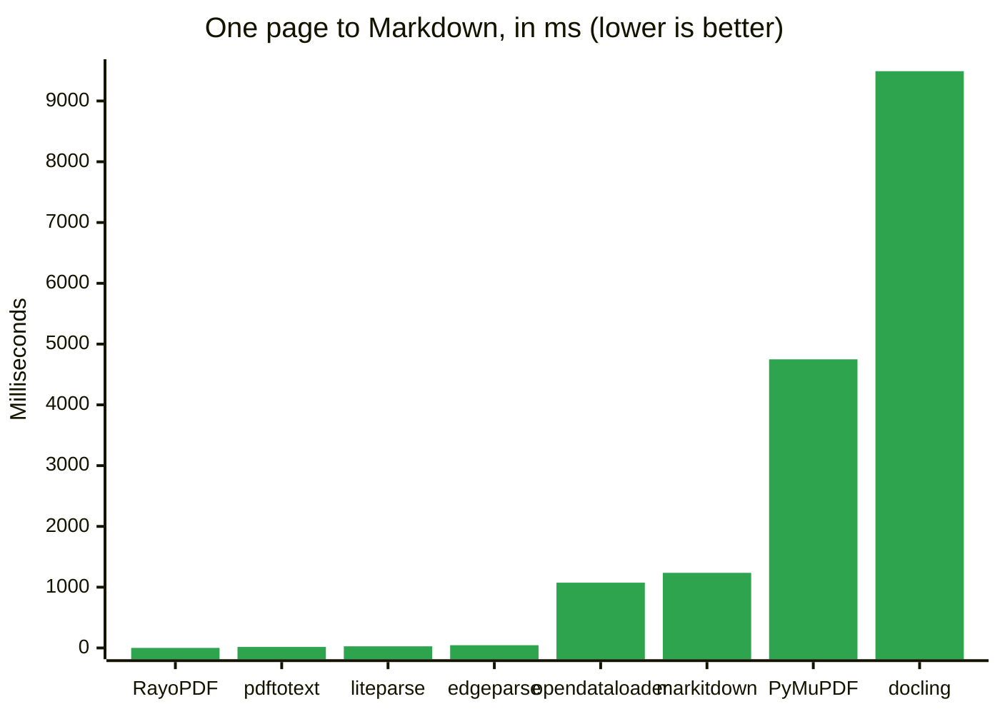

<a id="readme-top"></a>

<div align="center">

# RayoPDF

**PDF to Markdown in about a millisecond a page, from a single small executable.**<br>
No Python. No JVM. No models to download. The reverse of [RayoMD](https://github.com/Butterski/rayomd).

<a href="https://github.com/Butterski/rayopdf/releases"></a>
<a href="LICENSE"></a>

<a href="https://github.com/Butterski/rayopdf/actions/workflows/ci.yml"></a>
<a href="https://github.com/Butterski/rayopdf/actions/workflows/hygiene.yml"></a>


[Quick start](#quick-start) ·
[Benchmarks](#performance) ·
[Usage](#usage) ·
[Documentation](#documentation)

</div>

> [!TIP]
> **New in 0.0.14:** text order and tables on scientific papers (READoc arXiv segment order 0.967 → 0.981, tables 0.528 → 0.604) and round 5's speed cost won back. 0.0.13 brought headings on papers above every tool and images decoded on a document's threads.

RayoPDF reads a PDF and writes GitHub Flavored Markdown, in its own C++17 code: a small
command-line tool for Linux and Windows that starts, converts and exits in the time other tools
take to load. It is the reverse of [RayoMD](https://github.com/Butterski/rayomd), which writes
PDFs from Markdown.

## Status

Version 0.0.14: PDFs to GitHub Flavored Markdown with headings, paragraphs, lists, code blocks,
block quotes, alerts, emphasis, links, tables, footnotes and images, right-to-left and CJK text
included; tagged PDFs are read through their structure tree. Scanned pages and text inside images
are read by the optional OCR add-on; math is written as Unicode text, or as LaTeX with
`--math=latex`. 0.1.0 waits for the last item of its [release bar](docs/development/roadmap.md#goal-and-release-bar):
table structure on arXiv papers.

## Highlights

<table>
<tr>
<td width="33%" valign="top">

### Fast
A one-page PDF in under **1 ms**, start to exit; over 2,000 pages a second in a running
process; a long document's pages on up to four threads.

</td>
<td width="33%" valign="top">

### Small
A **1.6 MB** download: one static executable for Linux or Windows. No runtime, no model
files, 2 to 15 MiB of memory for most documents.

</td>
<td width="33%" valign="top">

### Structured
Headings, lists, tables, code, quotes, links, footnotes and images rebuilt from the page's
geometry; tagged PDFs read through their **structure tree**.

</td>
</tr>
<tr>
<td valign="top">

### Math
Formulas as Unicode text, or rebuilt as **LaTeX** (`--math=latex`): fractions, roots, sums,
matrices.

</td>
<td valign="top">

### Scans
An optional **OCR add-on** reads pages without text, sideways scans and text inside images, in
Latin, CJK and six more scripts.

</td>
<td valign="top">

### Careful
Every parser is **fuzzed**, every limit fails closed, and text that could not be read is marked
in the output, never dropped silently.

</td>
</tr>
</table>

## Quick start

<details open>
<summary><b>Build from source</b> (release archives start with 0.1.0)</summary>

The compilers live in a Docker image; nothing is installed on the host. Requirements: Linux,
Docker and Python 3.10 or newer.

```sh
python3 tools/dev.py image                    # the build image, once
python3 tools/dev.py build --config static    # build/static/rayopdf: one static executable
python3 tools/dev.py test --config windows    # build/windows/rayopdf.exe, tested under Wine
./build/static/rayopdf --convert input.pdf output.md
```

[CONTRIBUTING.md](CONTRIBUTING.md) has the other configurations, the tests and the OCR add-on's
build.

</details>

| Package | Size, 0.0.10 | For |
|---|---:|---|
| `rayopdf-<version>-linux-x64-static.tar.gz` | 1,592 KB | Linux: one static executable, no dependency |
| `rayopdf-<version>-windows-x64.zip` | 1,455 KB | Windows: `rayopdf.exe` |
| `rayopdf-ocr-<version>-<platform>` | 35 MB | The OCR add-on with its models, unpacked beside `rayopdf` |
| `rayopdf-ocr-scripts-<version>-<platform>` | 21 MB | Optional: Cyrillic, Korean, Arabic, Devanagari, Tamil, Kannada for the add-on |

## Performance

Measured on 2026-11-10 on an AMD Ryzen 5 PRO 4650GE, every tool in its own Docker image
without network. A one-shot conversion is a fresh process, start to exit.

### Against other tools

Each tool converts one page of text and tables (document 183 of
[opendataloader-bench](https://github.com/opendataloader-project/opendataloader-bench), its
median page) through its own command line, as a fresh process on one pinned core; the median of
3 to 40 runs.



| Tool | Version | One page | A 33-page report | Peak memory | Writes |
|---|---|---:|---:|---:|---|
| **RayoPDF** | 0.0.12 | **0.94 ms** | **11.8 ms** | **8 MiB** | Markdown |
| pdftotext | Poppler 25.03 | 17 ms (18×) | 46 ms (3.9×) | 18 MiB | plain text |
| liteparse | 2.18.0 | 27 ms (29×) | 138 ms (12×) | 33 MiB | Markdown |
| edgeparse | 0.3.2 | 45 ms (48×) | 306 ms (26×) | 27 MiB | Markdown |
| opendataloader | 2.5.19 | 1,074 ms (1,143×) | 3,705 ms (314×) | 250 MiB | Markdown |
| markitdown | 0.1.9 | 1,236 ms (1,315×) | 3,143 ms (266×) | 104 MiB | Markdown |
| PyMuPDF | 2.1, layout on | 4,749 ms (5,052×) | 70,092 ms (5,940×) | 346 MiB | Markdown |
| docling | 2.147.0, no OCR | 9,490 ms (10,096×) | 93,052 ms (7,886×) | 1,905 MiB | Markdown |

On four cores RayoPDF reads the report's pages on threads and takes 8.8 ms; the others take
38 ms to 42 s. In a running process (`--batch`, `--serve --json`) a page takes **0.37 ms** (median of
the benchmark's 200 pages; 2,215 pages a second on one core).

> [!NOTE]
> This compares the time to a finished file, not identical output: the tools differ in what they
> recover (the quality table below). A fresh process pays each tool's start: the Python tools
> import their packages and models, opendataloader starts a JVM; inside one running process
> edgeparse takes about 5 ms a page and PyMuPDF and docling about 2 s. Commands, versions and the
> four-core figures: [the record of 0.0.12](docs/benchmarks/v0.0.12-2026-11-10.md).

### Quality

The same tools on public benchmarks and on a synthetic corpus with exact ground truth
([how it is measured](docs/development/evaluation.md)); higher is better.

| Benchmark | RayoPDF | Best other text-layer tool | docling |
|---|---:|---:|---:|
| opendataloader-bench, 200 pages: overall | **0.896** | 0.885 | 0.884 |
| – text (NID) / tables (TEDS) / headings (MHS) | **0.918** / **0.886** / **0.839** | 0.914 / 0.818 / 0.822 | 0.902 / 0.879 / 0.827 |
| Synthetic corpus, 11 PDF producers: Markdown constructs (F1) | **0.951** | 0.628 | 0.560 |
| olmOCR-bench: multi-column / tables / headers and footers (pass rate) | **0.709** / **0.620** / 0.734 | 0.667 / 0.615 / 0.554 | 0.695 / 0.610 / **0.898** |
| olmOCR-bench: arXiv math, with `--math=latex` | **0.720** | 0.538 | 0.000 |
| READoc GitHub, 150 documents: text / headings | **0.941** / **0.881** | 0.874 / 0.778 | 0.908 / 0.471 |
| READoc arXiv, 150 papers, with `--math=latex`: text / headings / tables / order | **0.878** / **0.693** / 0.604 / 0.981 | 0.826 / 0.515 / **0.685** / 0.976 | 0.841 / 0.403 / 0.656 / **0.984** |
| READoc arXiv with `--math=latex`: inline math | **0.654** | 0.369 | 0.001 |
| Scanned pages, with the OCR add-on: text (NID) / constructs (F1) | **0.919** / **0.623** | 0.856 / 0.219 (tesseract) | 0.754 / 0.530 (with OCR) |

"Text-layer tools" are pdftotext, markitdown, PyMuPDF, opendataloader, liteparse and edgeparse;
docling is the machine-learning reference. RayoPDF 0.0.14, core alone unless the OCR add-on is named;
the READoc sets and one producer of the synthetic corpus are holdouts, scored once per version and
never inspected. Every table, per suite and per tool: [benchmark records](docs/benchmarks/README.md).

### Release by release

The 200 one-page PDFs of opendataloader-bench without images, one pinned core: pages a second in
one running process, and the median time of a fresh process per document (an empty static
program takes 0.22 ms in the same timer).

| Version | Warm, pages/s | Fresh process, one page | What changed |
|---|---:|---:|---|
| 0.0.7 | about 1,050 | 1.72 ms | the first complete converter |
| 0.0.8 | about 1,500 | 1.50 ms | numbers and glyph names read in one pass, fast paths for ASCII text |
| 0.0.10 | 1,560 | 1.22 ms | content lexer, line building, lazy font programs |
| 0.0.12 | **2,215** | **0.89 ms** | lexer loop inline, glyph placement, inflate, fonts, tables, hot code ordered, page threads |
| 0.0.13 | 2,138 | 0.91 ms | headings, tables and text on papers (they cost 3 %), images on page threads |

Every speed change is profiled, kept only if a pinned A/B shows it faster, and leaves the output
byte for byte the same on the whole corpus. [`performance.md`](docs/development/performance.md)
has the method, every step, and what was tried and rejected; `tools/bench.py` reruns the
measurements.

<p align="right"><a href="#readme-top">back to top ↑</a></p>

## Usage

```sh
rayopdf --convert IN.pdf OUT.md [--images=DIR|none] [--password=PW] [--pages=A-B]
                                [--ocr=auto|off|force] [--ocr-addon=PATH]
                                [--no-exact] [--no-annotations] [--no-structure] [--report]
                                [--math=unicode|latex] [--workers=N]
rayopdf --batch IN-FOLDER OUT-FOLDER [--recursive] [--skip-unchanged] [--report[=FILE]]
                                     [--workers=N] [--images=none] [--password=PW] ...
rayopdf --serve --json [--workers=N] [--images=none] [--password=PW] ...
rayopdf --inspect IN.pdf [--password=PW]   # the document's structure as one JSON object
rayopdf --version | --help
```

`OUT.md` `-` writes to standard output. Images go to `OUT-images/` beside `OUT.md` (PNG, or the
PDF's own JPEG data when that file shows what the PDF shows) unless `--images` says otherwise.
Text that could not be read is never dropped silently: a `<!-- rayopdf: ... -->` comment marks
the spot. Exit codes: 0 converted, 2 usage, 3 unreadable input, 10 corrupt beyond repair, 11
password required, 12 unwritable output, 13 unsupported encryption.

Formulas are written as Unicode text with `<sup>`/`<sub>` by default. `--math=latex` writes them
as LaTeX instead, rebuilt from the glyphs' positions: inline formulas as `$…$`, displayed ones as
`$$…$$` (an equation number follows as `(n)`), with fractions, radicals, scripts, limits,
matrices and cases; a formula it cannot rebuild stays Unicode text, a number in a table cell
(`−0.1`, `308±6`) stays text as in the default mode, and a `$` of the text is written `\$` where
it could open a formula (`$8,000` stays as it is).

`--report` prints one JSON record of the document: `input`, `output`, `status` (`ok`, `skipped`
or `error`), `code` (the exit code), `error` when it failed, `pages`, `bytes` (of Markdown), `ms`,
then the counters behind the uncertainty comments (glyphs without Unicode, pages without text,
repairs, limits reached, `exact`, ...).

`--workers=N` (1 to 64) never changes the output. With `--convert` it is the number of pages of
the document read at once (by default up to one a CPU and at most 4, each thread started only
when the pages read so far are worth it).

### Exact recovery of RayoMD PDFs

A PDF that [RayoMD](https://github.com/Butterski/rayomd) exported with `--embed-source` carries
its Markdown source (the `rayomd-source/1` profile). RayoPDF then writes that Markdown byte for
byte instead of converting the pages, once two checks pass: the profile's own (its exact object
layout, length, SHA-256 and UTF-8), and a comparison with the pages: the letters and digits of
the source, compared in runs of 8 with the normal conversion's, may miss or add at most 32 plus
20 % of either side's (link and image targets, TeX commands of formulas, comments). The digest
detects damage, not forgery, and the comparison does not cover punctuation, Markdown syntax or
link targets beyond that allowance. The profile carries no images: the source's image links stay
as written and no image files are written. The record's `exact` says what happened: `used`,
`none` (no payload), `off` (`--no-exact`), `pages` (not used with `--pages`), or why the payload
was rejected and the pages converted instead: `unsupported`, `corrupt`, `integrity`, `limit`,
`utf8`, `mismatch`. `--no-exact` always converts the pages.

### OCR add-on

Pages without a text layer (scans) and text drawn inside images or as outlines are read by a
separate program, `rayopdf-ocr`, shipped in its own archive with its models
(`rayopdf-ocr-models/`, PP-OCRv6 small and tiny on ncnn; about 7 MB plus 36 MB). Unpacked into
the same folder as `rayopdf`, it is found and started only when a page needs it; pages with a
usable text layer never wait for it. It reads Latin and CJK text, turns pages scanned sideways or
upside down upright, and also reads the shapes of glyphs whose font maps them to no or wrong text.
The optional script pack `rayopdf-ocr-scripts-VERSION-<platform>` (about 21 MB), unpacked over
the add-on, adds Cyrillic, Korean, Arabic, Devanagari, Tamil and (roughly) Kannada; a script's
model loads only when a page needs it. Hebrew is not read yet. Without the add-on, those pages
keep the `<!-- rayopdf: page N has no extractable text -->` comment. `--ocr=off` never starts it,
`--ocr=force` also re-reads pages that already carry an invisible OCR layer; `--ocr-addon=PATH` or
the `RAYOPDF_OCR` environment variable name it elsewhere (otherwise: beside `rayopdf`, then
`PATH`). The record counts routed, recognised and failed pages (`ocr_pages_routed`, `ocr_pages`,
`ocr_failures`, `ocr_addon_missing`, ...). An OCR page takes seconds, not milliseconds: about 2 s
on one core for a 300 dpi Latin page, more for other scripts.

### Batch conversion

`--batch` converts every `*.pdf` of a folder (any case of `.pdf`) to `OUT-FOLDER/NAME.md`, its
images to `OUT-FOLDER/NAME-images/`. `--recursive` adds the subfolders, except hidden ones, mirrored
under `OUT-FOLDER`; `--skip-unchanged` keeps Markdown files at least as new as their PDF; `--report`
writes one record a document, in the sorted order of the inputs, to standard output or to FILE.
`--workers=N` converts N documents at once (1 to 64; by default one a CPU, at most 6). The files and
records do not depend on N, only the `ms` of each record. The exit code is 0 when every document
converted, else the code of the last one that failed (in input order); stderr names each failure.

```sh
rayopdf --batch papers md-out --recursive --skip-unchanged --report=report.jsonl --workers=8
```

### Front ends: `--serve --json`

`--serve --json` keeps one process running for an editor plugin, an agent tool or a script, with
[RayoMD](https://github.com/Butterski/rayomd)'s protocol 1: each line in is a JSON request, each
line out is the request's record with its `id`. The first line out is
`{"rayopdf":"VERSION","protocol":1}`. A request has `input` (a PDF), optionally `id` (a string or
an integer, sent back as it came), `output` (a Markdown file; without it the record carries the
Markdown as `markdown` and no images are written) and `args` (flags of `--convert`:
`--password`, `--pages`, `--images`, `--no-exact`, `--no-annotations`, `--no-structure`, `--math`,
`--ocr`, `--ocr-addon`, over those
the session started with). A malformed request gets an error record (code 2) and the session goes
on; `quit`, `exit` or the end of the input ends it. With `--workers=N` requests already sent are
converted N at a time, and the answers still come in request order.

```sh
printf '%s\n' '{"id":"1","input":"a.pdf","output":"out/a.md","args":["--pages=1-3"]}' \
  '{"id":2,"input":"b.pdf"}' | rayopdf --serve --json
```

<p align="right"><a href="#readme-top">back to top ↑</a></p>

## Boundaries

- **Not a renderer.** RayoPDF recovers text and structure; it does not rasterise pages, and a
  figure made of vector drawings is not turned into an image.
- **Tables in scientific papers** score below the best tools on arXiv papers (the quality table
  above).
- **Math** is rebuilt from glyph positions, not recognised from pixels: formulas in scanned pages
  stay text.
- **Scans need the add-on**, and OCR takes seconds a page, not milliseconds. Hebrew is not read
  yet; Arabic and Kannada are rough.
- **Encrypted PDFs** need the password (`--password`); certificate encryption is not supported.
- **Tables with cells spanning rows** (or columns below the header) are written as HTML tables
  inside the Markdown; everything else is GFM.
- **Memory** grows with the largest JPEG or JPEG 2000 image of a document when images are
  written, and with the input file, which is mapped.

## Documentation

| Topic | Where |
|---|---|
| Decisions, milestones and the release bar | [Roadmap](docs/development/roadmap.md) |
| Suites, metrics, competitors, how to rerun the evaluation | [Evaluation](docs/development/evaluation.md) |
| Every version on the harness, baselines, release checks | [Benchmark records](docs/benchmarks/README.md) |
| Speed: method, steps, rejected attempts | [Performance](docs/development/performance.md) |
| The OCR add-on: engine, build, pipe protocol, decision | [OCR engine](docs/development/ocr-engine.md), [protocol](docs/development/ocr-protocol.md), [decision](docs/development/ocr_ml_decision.md) |
| Research notes | [Landscape](docs/research/landscape.md), [algorithms](docs/research/algorithms.md), [OCR and ML](docs/research/ocr-ml.md), [speed](docs/research/speed.md) |
| Reporting a vulnerability | [SECURITY.md](SECURITY.md) |

## Contributing

[CONTRIBUTING.md](CONTRIBUTING.md) says how to build, test, fuzz and measure, and
[AGENTS.md](AGENTS.md) holds the rules in short form. The core stays its own code with no runtime
dependency; a change to the output comes with its scores on the evaluation harness, a change to
the speed with before and after measurements and identical output; benchmark claims stay dated
and scoped; builds, PDFs and corpora stay out of the repository.

## License

Apache-2.0. See [LICENSE](LICENSE) and [NOTICE](NOTICE).

<p align="right"><a href="#readme-top">back to top ↑</a></p>
